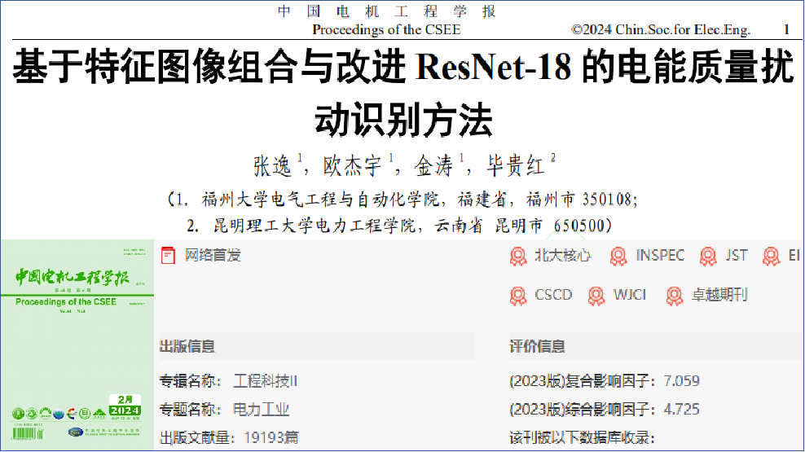
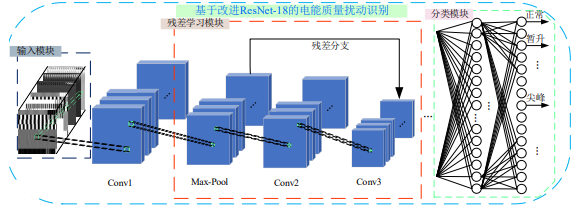
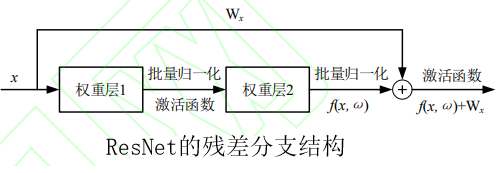
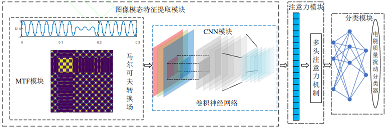
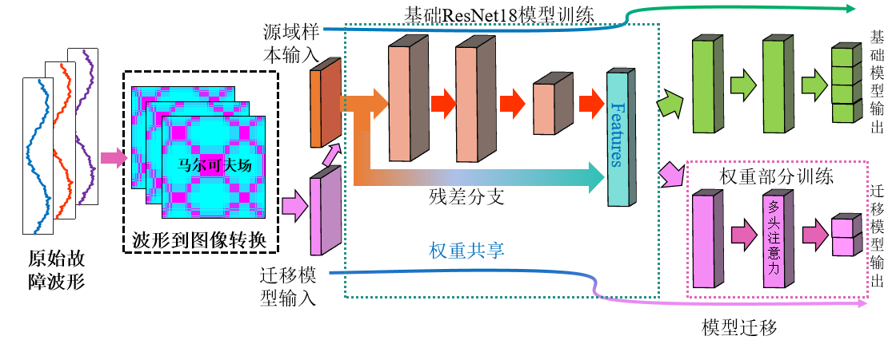
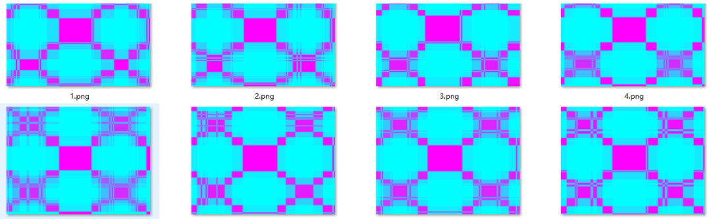
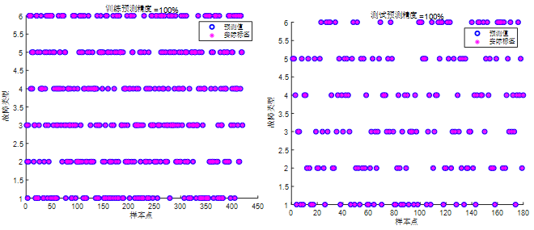

# Seconds to Understand! ResNet + Transfer Learning + Markov Field for Fault Identification Program! Sufficient for a high-level academic paper! Run directly!

Applicable Platform: Matlab2023 and above.
Transfer learning fault identification program based on Markov Field (MTF) and improved ResNet with multi-head attention mechanism.
References:
1. Chinese top-tier EI journal "China Electric Power Engineering Journal" recently published literature: "A fault identification method for power quality disturbances based on feature image combination and improved ResNet-18."
Work interpretation of reference one: Utilize the "signal-image" transformation method to generate feature component color maps; then, generate wavelet time-frequency diagrams of the original disturbance signals using CWT; finally, combine the feature component color maps with the wavelet time-frequency diagrams to input into the improved ResNet-18 for training and complete fault identification.
The innovation of ResNet lies in the use of a novel residual module during network construction, as shown in the figure below. The residual module adds a bypass branch on the single convolutional path, making the output of subsequent layers dependent on the input (f(x,ω)) at the previous layer and the input (Wx) at the connection point. ResNet leverages the special structure of multiple residual modules to significantly reduce its parameter size, alleviate network degradation issues, and facilitate the extraction of deep features from images.
Innovation of reference two: This paper's innovation lies in the combination of Markov Field (MTF) and Convolutional Neural Networks (CNN), incorporating multi-head attention mechanisms to achieve fault classification. MTF converts one-dimensional signals into two-dimensional feature maps, while CNN can perform adaptive feature extraction and classification on these feature maps. The integration of multi-head attention mechanisms effectively grasps the contribution level of extracted features, achieving accurate fault classification.
The MTF-ResNet-SMA Transfer Learning Fault Identification Program:

1. The MTF-ResNet-SMA Transfer Learning Fault Identification Program combines the improved ResNet18 model from literature one with the MTF Markovian Field (MTF) model from literature two, introducing a multi-head attention mechanism for transfer learning fault identification. This program is innovative and robust enough to support high-level academic papers or simple graduation projects.

2. The program requires only raw fault waveform data to transform a one-dimensional sequence into a two-dimensional MTF Markovian Field image based on the waveform data.

3. Starting with the pre-trained ResNet18 model, it undergoes fine-tuning on new fault identification datasets. Since different research topics and fault categories exist, it is necessary to freeze some layers of the pre-trained ResNet18 model.

4. It improves the output layer by adding a multi-head self-attention (MSA) layer, retraining these layers to adapt to the new classification task. The structure of this model is shown in the figure below.

5. The six main innovations are as follows:
   1. Time-series visualization: Transforming a one-dimensional time series signal into a two-dimensional image, thus more comprehensively describing the data's features. This helps extract richer and more discriminative features, thereby improving classification and recognition accuracy.
   2. Spatial feature learning: Leveraging the special structure of multiple residual modules reduces the network's parameter size significantly, alleviating network degradation issues and facilitating deep feature extraction in images. Using ResNet18 for image data processing can help extract texture, shape, and edge features of images, aiding in more accurate classification and fault identification.
3. Transfer Learning: Fully leverage the ResNet18 model pre-trained on large-scale datasets, standing on the shoulders of giants and drawing from the strengths of many others. Through transfer learning, we perform fine-tuning on the fault identification task, demonstrating strong feature extraction capabilities.
4. Training time is short: Focuses on training the model's weight for fine-tuning, maintaining a low computational complexity, which is conducive to real-time application scenarios.
5. Multi-head Self-Attention Mechanism: The integration of the Multi-head Self-Attention (MSA) mechanism effectively captures the contribution of feature extraction, enhancing the focus on key features to improve the accuracy of fault identification.
6. Enhance Generalization Ability: Multimodal fusion can help algorithms better understand the essential characteristics of data, thereby reducing the risk of overfitting and enhancing the algorithm's generalization ability on new data.
Applicable fields: Suitable for various data classification scenarios, such as rolling bearing faults, transformer oil gas faults, power system transmission line fault areas, insulators, distribution networks, and disturbances to power quality.
Simply replace the data, directly importing it into an Excel spreadsheet without significantly modifying the program. The program includes detailed comments for ease of understanding its operation.
Data format: Each row represents a sample, with the last column being the fault type label of the sample.
\n        \n      Result of the program: (Automatically converted from the aforementioned one-dimensional sequence into a Markov Field MTF image)
Program Result:

## Images

<!-- PAYMENT_BLOCK -->

## Get this dataset

- Payment link (Stripe): [Buy now](https://buy.stripe.com/3cs8yP7sY87d0vu9AB)
- Payment QR code: 

<!-- /PAYMENT_BLOCK -->
